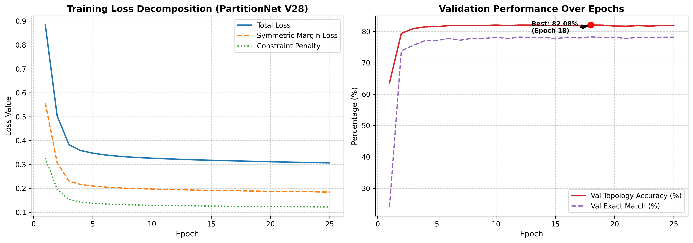
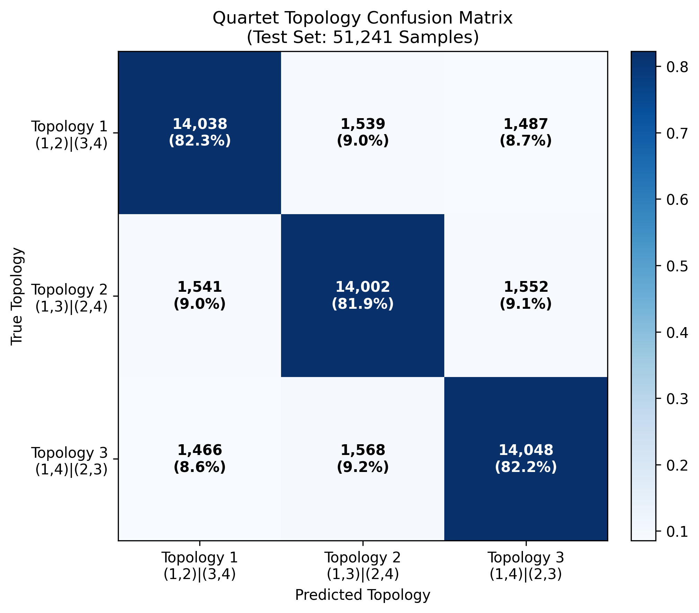

<div align="center">

# PartitionNet (v28-eq-vector)
### Taxon-Permutation-Equivariant Neural Architecture for Phylogenetic Quartet Partitioning

[](https://www.python.org/downloads/)
[](https://pytorch.org/)
[](https://opensource.org/licenses/MIT)
[](#-permutation-equivariance-guarantee)

</div>

---

## 📖 Overview

**PartitionNet** is a deep learning framework designed for phylogenetic quartet topology inference. Given multiple sequence alignment (MSA) chunks of 4 taxa $\mathcal{T} = \{t_1, t_2, t_3, t_4\}$, PartitionNet predicts the true unrooted evolutionary tree topology among the 3 canonical unrooted quartet topologies:

| Topology | Canonical Partition | Bipolar Vector Representation ($y \in \{-1, +1\}^4$) |
|:---:|:---:|:---:|
| **Topology 1** | $(t_1, t_2) \mid (t_3, t_4)$ | `[+1, +1, -1, -1]` $\equiv$ `[-1, -1, +1, +1]` |
| **Topology 2** | $(t_1, t_3) \mid (t_2, t_4)$ | `[+1, -1, +1, -1]` $\equiv$ `[-1, +1, -1, +1]` |
| **Topology 3** | $(t_1, t_4) \mid (t_2, t_3)$ | `[+1, -1, -1, +1]` $\equiv$ `[-1, +1, +1, -1]` |

---

## 🔒 Permutation Equivariance Guarantee

A major challenge in neural phylogenetic inference is **taxon ordering sensitivity**: standard feed-forward networks often output inconsistent predictions when input sequence orders are arbitrarily permuted.

PartitionNet guarantees exact **permutation equivariance**:
$$\mathbf{z}(\pi(\mathbf{x})) = \pi(\mathbf{z}(\mathbf{x})) \quad \forall \pi \in \mathcal{S}_4$$

- **Pair Feature Builder**: Computes symmetric pairwise embeddings for all unordered pairs $\{i, j\}$ ($P = \binom{n}{2} = 6$).
- **Relational Triangle Layer**: Pair $(i, j)$ aggregates evolutionary context across all intermediate taxa $k$ using relational pair contraction:
  $$T_{ij} = \frac{1}{n-2} \sum_{k \neq i, j} H_{ik} \odot H_{jk}$$
- **Content-Based Reference Anchor**: Dynamically selects reference taxon $r$ via an invariant content-hash projection rather than sequence indexing order, preserving exact permutation equivariance.

---

## 🏗️ Repository Architecture

```text
PartitionNet/
├── configs/
│   ├── default.yaml            # Standard hyperparameter and training configuration
│   └── kaggle.yaml             # Preset for Kaggle GPU environments
├── partitionnet/                # Core Python package
│   ├── __init__.py             # Public API exports
│   ├── config.py               # Dataclass configuration definitions
│   ├── data/
│   │   ├── dataset.py          # NumericRAMDataset for chunked HDF5 sequences
│   │   ├── sampler.py          # TrainChunkBasedDynamicSampler (OOM-safe batching)
│   │   └── collate.py          # ChunkCollator with reusable preallocated memory buffers
│   ├── models/
│   │   ├── layers.py           # PairFeatureBuilder, DilatedContractingBlock, ChunkAttentionAggregation
│   │   ├── partitionnet.py     # PartitionNetEq (permutation-equivariant model)
│   │   └── loss.py             # StableSymmetricBipolarLoss
│   └── utils/
│       ├── memory.py           # Seed control, memory trimming, state dict cleaning
│       ├── metrics.py          # Topology decoding, exact match, Hamming loss
│       └── invariance.py       # 24-taxon permutation test suite
├── notebooks/
│   └── partitionnet_v28_tutorial.ipynb  # Interactive tutorial walkthrough
├── results/                    # Curated evaluation results and pretrained weights
│   ├── pnet_v28_eq_best.pth    # Pretrained best model weights (Epoch 18)
│   ├── pnet_v28_eq_chkpt.pth   # Resumable training checkpoint (Epoch 25)
│   ├── pnet_v28_eq_preds.npz   # Test set predictions (logits & labels)
│   ├── pnet_v28_eq_results.json# Detailed test evaluation metrics
│   ├── training_log_eq.csv     # Full training log across epochs
│   ├── training_curves.png     # Visual loss decomposition & validation curves
│   └── confusion_matrix.png    # Test set quartet topology confusion matrix
├── scripts/
│   ├── train.py                # Command-line training pipeline
│   ├── evaluate.py             # Checkpoint evaluation & permutation testing
│   └── plot_metrics.py         # Automated visualization script
├── tests/
│   ├── test_model.py           # Unit tests for output shapes and equivariance
│   └── test_loss.py            # Unit tests for bipolar loss symmetry
├── pyproject.toml              # Packaging and dependency specifications
├── requirements.txt            # Package dependencies
└── README.md                   # Project documentation
```

---

## ⚡ Installation

Clone the repository and install it in editable mode:

```bash
git clone https://github.com/nqHuynq/PartitionNet.git
cd PartitionNet

# Create and activate a virtual environment (optional but recommended)
python -m venv venv
source venv/bin/activate  # On Windows: venv\Scripts\activate

# Install dependencies and PartitionNet
pip install -e .
```

---

## 🚀 Quickstart

### Python API (Inference with Pretrained Weights)

Pretrained model weights are provided at `results/pnet_v28_eq_best.pth`. You can load the weights and run inference directly:

```python
import torch
from partitionnet import PartitionNetEq
from partitionnet.utils.metrics import decode_topos
from partitionnet.utils.invariance import check_permutation_invariance

# 1. Initialize model and load pretrained weights
device = torch.device('cuda' if torch.cuda.is_available() else 'cpu')
model = PartitionNetEq(window=2048).to(device)
model.load_state_dict(torch.load("results/pnet_v28_eq_best.pth", map_location=device))
model.eval()

# 2. Synthetic input: (Batch=2, Chunks=2, Taxa=4, Window=2048)
x = torch.randint(0, 4, (2, 2, 4, 2048), dtype=torch.uint8).to(device)

# 3. Predict partition logits and decode quartet topologies (1, 2, or 3)
with torch.no_grad():
    logits = model(x)                     # Shape: (2, 4)
    pred_topos = decode_topos(logits.cpu().numpy())
    print(f"Predicted Quartet Topologies: {pred_topos}")

# 4. Verify exact permutation equivariance
worst_diff, agreement = check_permutation_invariance(model, x)
print(f"Max logit diff under permutations: {worst_diff:.3e}")
print(f"Topology agreement across all permutations: {agreement * 100:.1f}%")
```

---

## 🏋️‍♂️ Training & Evaluation

### Training with CLI

```bash
python scripts/train.py \
  --data-dir ./data/IQNet_Numeric_H5 \
  --epochs 35 \
  --batch-size 32 \
  --lr 1e-4 \
  --accum-steps 16 \
  --output-dir ./outputs
```

### Evaluation & Permutation Testing

```bash
python scripts/evaluate.py \
  --checkpoint ./results/pnet_v28_eq_best.pth \
  --test-file ./data/IQNet_Numeric_H5/iqnet_test.h5 \
  --perm-test \
  --output-json ./results/eval_results.json
```

---

## 🧪 Loss Function: StableSymmetricBipolarLoss

Since phylogenetic splits are sign-symmetric ($y \equiv -y$), standard BCE or MSE losses are ill-suited. PartitionNet employs **StableSymmetricBipolarLoss**:

$$\mathcal{L} = \min\big(\text{softplus}(-\mathbf{y} \cdot \mathbf{z}), \text{softplus}(\mathbf{y} \cdot \mathbf{z})\big) + \lambda_{\text{penalty}} \left( \frac{1}{4} \sum_{i=1}^4 \tanh\left(\frac{z_i}{\tau}\right) \right)^2 + \lambda_{\text{pair}} \mathcal{L}_{\text{pair}}$$

1. **Symmetric Margin Loss**: Invariant to global label sign inversion.
2. **Balanced Bipolar Constraint**: Penalizes unbalanced predictions away from equal $2 \mid 2$ partitions.
3. **Auxiliary Pair Loss**: Directly supervises pairwise relational edges ($y_i y_j > 0$).

---

## 🔬 Benchmark Results

The following empirical results are taken directly from the official test evaluation log of **PartitionNet V28**:

### 1. Overall Performance on Test Set (51,241 Samples)

| Metric | Anchor Model (v27) | PartitionNet (v28-eq-vector) | Notes |
|:---|:---:|:---:|:---|
| **Topology Accuracy** | 82.04% | **82.14%** (+0.10%) | Quartet topology decoding accuracy on test set |
| **Exact Match** | — | **0.7831** | Fraction of samples with exact bipolar partition vector match |
| **Hamming Loss** | — | **0.1087** | Average Hamming loss on partition bits |
| **Best Validation Accuracy** | — | **82.08%** (Ep 18) | Peak validation accuracy achieved during training |
| **Permutation Topo Agreement** | — | **100.00%** | 100% topology prediction consistency across all 24 taxon permutations ($4!$) |
| **Permutation Max Logit Diff** | — | **2.027e-05** | Numerical precision limit; exact equivariance achieved |
| **Topo Accuracy over all 24 Perms** | — | **80.08%** | Average classification accuracy evaluated across all 24 permutations |

### 2. Per-Topology Breakdown (Classification Report)

The test dataset comprises 51,241 samples uniformly distributed across the 3 unrooted quartet topologies:

| Topology | Partition Split | Precision | Recall | F1-Score | Support |
|:---|:---:|:---:|:---:|:---:|:---:|
| **Topology 1** | $(t_1, t_2) \mid (t_3, t_4)$ | **82.36%** | **82.27%** | **82.31%** | 17,064 |
| **Topology 2** | $(t_1, t_3) \mid (t_2, t_4)$ | **81.84%** | **81.91%** | **81.87%** | 17,095 |
| **Topology 3** | $(t_1, t_4) \mid (t_2, t_3)$ | **82.21%** | **82.24%** | **82.23%** | 17,082 |
| **Macro Average** | — | **82.14%** | **82.14%** | **82.14%** | 51,241 |
| **Weighted Average** | — | **82.14%** | **82.14%** | **82.14%** | 51,241 |

### 3. Training Dynamics & Confusion Matrix

<div align="center">
  
  <br><br>
  
</div>

---

## 📄 License
This project is licensed under the MIT License - see the [LICENSE](LICENSE) file for details.
